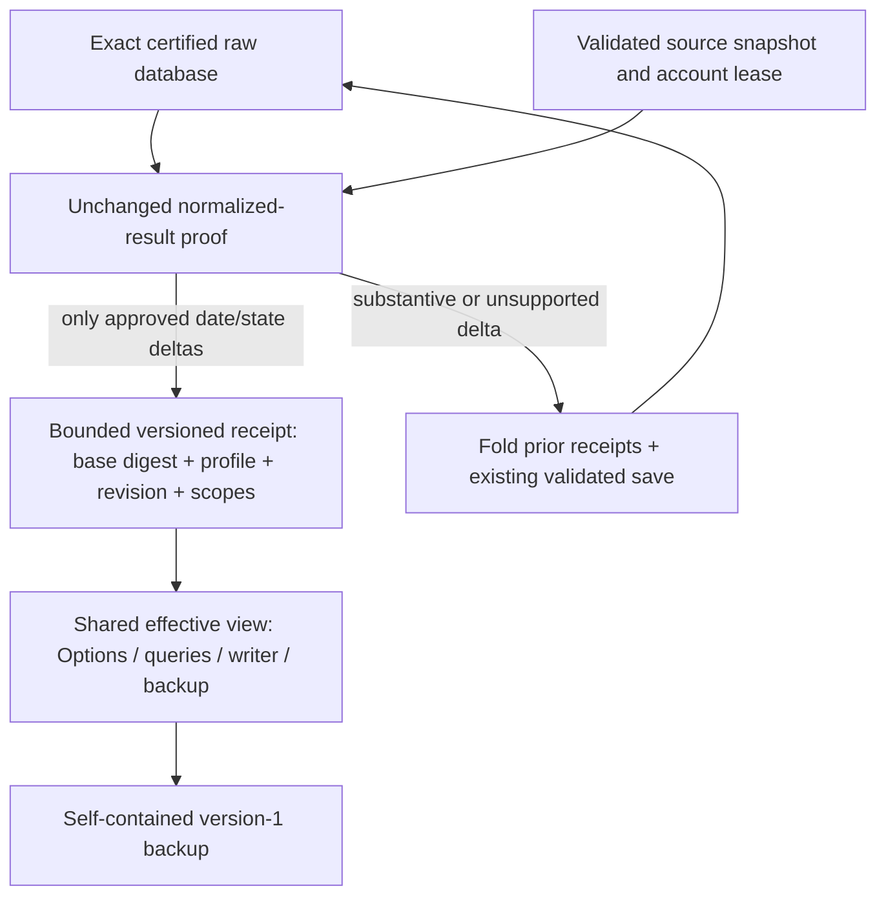
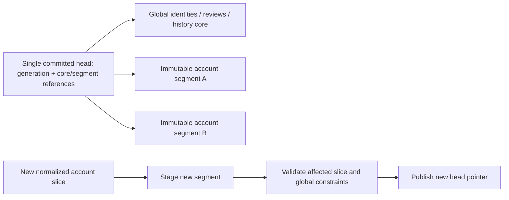
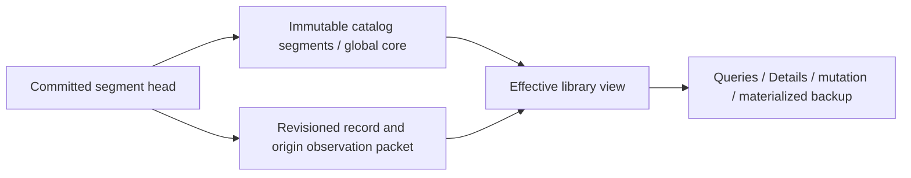

# Unchanged full-scan completion: architecture decision

## Stage 2 — completion and automatic recovery (October 17, 2026)

Baseline: `d68ab4a`. **Stage 2 enables unchanged completion on Chrome and Firefox;
the corrected performance and release gates pass.**
The controlled cold-matching diagnosis below supersedes the initial stopped
measurements. Live Epic acceptance and public release remain separate. The Stage 1 and investigation sections below
describe earlier states. No real library, authenticated provider data, backup,
HB/FAN repository, version or public release was changed during development.

### Eligibility and exact semantics

The existing `replaceIntoDatabase` / `mergeIntoDatabase` paths still validate
source completeness/account binding, normalize returned records, preserve
enrichment/origins, reconcile history, calculate counts/health, and derive
canonical groups. Before the ordinary full validation/save, an eligible established
lease can compare that prepared result with its authoritative effective input.
[observation-completion.js](../../src/lib/observation-completion.js) permits only
record observation/update clocks, existing origin observation clocks, and the
closed successful state patch. Everything else must agree, including every
canonical group, record reference, review, history entry, source field, origin
order/membership, acquisition date, identity and ownership value. This reuses the
actual importer, not a simplified second normalizer. Zero UI updates alone prove
nothing. Canonical reconciliation is retained to catch order-dependent grouping
differences; skipping it is not part of this change.

Complete uniform scopes use compressed profile observations when supported.
Subset scopes enumerate only returned records. Fanatical always uses explicit
records/origins and can retain independently observed origins across scans. Kobo
full retains updatedAt; its unchanged sparse quick path still preserves both
record clocks and can use the existing status-only receipt. Xbox/PlayStation quick
subsets can use explicit observations without advancing retained rows.

**Console full scans deliberately retain the validated fallback.** Their existing
additive importer produces incremental-mode health even for a full listing. The
closed success contract does not reinterpret that as full-mode health. Nintendo's
only mode therefore remains a full save. No completeness or acquisition rule was
changed to force eligibility. Changed metadata/access/identifiers, additions,
removals, reappearances, history/canonical changes, account changes, unsupported
state changes and packet bounds all retain the current validated full-save path.
Incomplete/failed/cancelled results never become successful observation receipts.

Raw catalogs remain exactly validated: a warm exact snapshot or a verified cold
session certificate can be reused; absent/mismatched proof requires ordinary
validation first. No new certificate certifies an effective view. The payload
limits remain 1 MiB, 14 providers, 5,000 explicit records, 10,000 origins and three
superseded status-attempt references. Overflow materializes through the full save.
Fanatical's existing health may count an origin-date refresh as an update; that
bounded health count is preserved after the full substantive-delta proof.

### Single-value commit and recoverable materialization

[observation-transactions.js](../../src/lib/observation-transactions.js) adds a
closed format-2 envelope under `galacticLibraryObservations`:

- Active: epoch UUID, exact raw base digest, consolidated format-1 payload or null,
  and at most one terminal completion identity per provider (14 maximum).
- Saving: the prior complete active envelope, intended after-digest/epoch,
  reset intent, optional terminal scan identity, and before/after values for the
  operation's affected metadata keys. It never duplicates the full database.

`galacticLibraryObservationHead` is now a small registration marker, not a
separately updated revision pointer. Initial admission writes a complete empty
envelope before registering it. Interrupted registration is repaired before a
later acknowledgement. A valid complete envelope is independently readable;
missing data behind an existing registration is corruption, not an empty library.
Existing Stage 1 injected pairs remain readable; no historical binary downgrade
protocol was added.

Successful unchanged completion rechecks the raw catalog and observation token,
writes **one complete consolidated envelope value**, awaits native settlement,
publishes the effective revision, then attempts lease retirement. That native
settlement is the commit point. A lost settlement reply is checked by rereading
the exact attempted value. No success is acknowledged for a rejected/unconfirmed
write. Durable attempt/token/tab/profile/mode/account identity and a digest of the
request make a retry idempotent even after lease cleanup. Reusing a completed
token with different results is rejected. Request comparison excludes only the
server-generated full/quick sync timestamps, which must retain their original
committed values on retry. Independent providers pin their own observation
attempt, so one receipt need not invalidate another provider's admitted scan.

Before a real full save, the writer durably records the saving envelope. It then
writes the fully validated database and its metadata, followed by an active empty
envelope on the new base. Recovery hashes the authoritative raw database:

| Authoritative database | Recovery action |
| --- | --- |
| Matches intended after-digest | Replay the after-metadata; retire the already folded packet. |
| Matches before-digest only | Restore before-metadata and the complete prior packet. |
| Matches neither | Preserve evidence and report genuine corruption. |

Restore/clear use the same journal with reset intent. Clear's after-base is absence.
If an explicit restore replaces an identical raw value, recovery can finish its
metadata/reset intent without another catalog write. Pending journals keep all
affected scan/job/preferences metadata; no cross-key atomicity is presumed.
Concurrent local queries retain the prior complete view while a save is in flight,
including restore/clear; they cannot prematurely roll back that writer's journal.
A rollback with an unchanged raw catalog retains its matching index. Recovery
also retains committed terminal identities for changed-scan fallbacks, so lost
full-save replies can be retried safely.

When a proved observation-only delta must fall back because the packet is at its
bound, the validated new raw snapshot can reuse the prior identity revision.
Raw digest/certificate association remains separate and uses the new raw value.
Late-bound response records use current dates/access. The revision is a lightweight
opaque token, not an accumulating catalog chain. Cached candidate indexes contain
record IDs and history references, so compaction need not retain old complete
records or raw databases. A cold worker still builds its index once. The bounded-status-lineage
regression exercises real receipt growth followed by a full compaction and checks
that this does not cause a second matching-index build.

The commit boundary follows the native API, not an invented disk flush guarantee:
[Chrome storage](https://developer.chrome.com/docs/extensions/reference/api/storage)
is asynchronous and signals completion through its Promise; GL's Firefox adapter
settles on the IndexedDB transaction's complete event. Firefox documents relaxed
[IndexedDB durability](https://developer.mozilla.org/en-US/docs/Web/API/IDBTransaction#firefox_durability_guarantees).
These tests establish worker/background restart recovery, not durability against
OS/power loss. Invalid receipts, unknown versions and unreadable storage block
rather than silently discarding committed observations. Genuine corruption still
requires explicit recovery; routine interrupted valid operations do not.

### Initial stopped measurements against Stage 1 (historical)

`scripts/benchmark-observation-completion.mjs` uses unmodified production packages,
14,004 synthetic records and 2,800 returned records. Each version/browser ran five
warm unchanged full completions, 20 samples for Exact/Possible/Partial/batch/
aggregation matching and three real background restarts. The harness uses full
storage-client replies; real provider replies are compact. Provider network work
is zero; the diagnostic interval between calls is not acquisition time. These
lean fixtures are not predictions for the developer's larger real metadata.

Milliseconds, **median (range)**:

| Measurement | Chrome Stage 1 | Chrome Stage 2 | Firefox Stage 1 | Firefox Stage 2 |
| --- | ---: | ---: | ---: | ---: |
| Preparation | 487 (475–512) | 523 (516–562) | 768 (718–805) | 1,004 (967–1,221) |
| Completion | 2,454 (2,415–2,558) | 818 (763–941) | 1,345 (1,335–1,518) | 1,243 (1,183–1,285) |
| Both messages | 2,932 (2,928–3,064) | 1,334 (1,288–1,464) | 2,141 (2,063–2,299) | 2,239 (2,210–2,404) |
| First 40-item match after completion | 516 (479–585) | 5 (4–7) | 219 (170–250) | 17 (13–20) |
| Standalone materialized backup validation | 724 (704–791) | 853 (798–910) | 470 (468–479) | 614 (578–688) |

Every eligible completion changed from **one full write + one full validation**
to **zero full writes + zero full validations + one bounded receipt commit**.
Across the ten native measured completions, ten full writes/validations were
avoided. Chrome's median receipt settlement was about 1 ms; equality proof
55 ms, consolidation 16 ms, materialization 8 ms and publication 21 ms. Firefox's
corresponding medians were 0/30/3/4/8 ms (zero is timer resolution). Nested spans overlap. Authoritative
whole-value reads and mutable clones remain; full canonical reconciliation remains
part of the oracle proof. Backup reads still validate/materialize a full database:
Chrome getDatabase median was 1,062 ms versus 738 ms, Firefox 1,318 versus 925 ms.
No backup-speed improvement is claimed.

Warm post-scan 40-item median/p95 was Chrome **2.6/3.1 ms** versus **2.9/3.8 ms**,
Firefox **10/15 ms** versus **7/8 ms**. Exact and Possible remain around 0.6–1 ms;
Partial medians were Chrome 13.4 versus 11.1 ms and Firefox 7 versus 8 ms. Cold
40-item medians were **940 versus 716 ms Chrome** (ranges 939–1,198 / 700–743)
and **2,014 versus 1,435 ms Firefox** (2,013–2,103 / 1,429–1,547).
Firefox reload loses session proof and must validate its raw base; Chrome worker
stops retain proof. Tests show no observation-induced matching-index rebuild and
current evidence timestamps. **checkedAt is retained.**

Those cold increases triggered the original matching acceptance stop.
Earlier pilot medians were closer, but did not override those
measurements. Other timings also vary, including preparation and backup work.
The additional cold interval has not been attributed reliably to execution,
storage, receipt reconstruction or competing work. A fresh-writer probe in a
background extension page instead encounters heavily throttled page timers, so
its wall times cannot substitute for worker measurements. No cache/lifecycle
redesign was attempted to conceal this gap. Work stopped without a commit;
the following controlled diagnosis addresses that blocker.

### Cold-matching diagnosis and narrow correction — October 17, 2026

The original 26 staged files, unstaged diff and benchmark artifacts were preserved
under ignored `audit-artifacts/observation-stage2/cold-diagnosis-before/`. Stage 1
remained a clean detached `d68ab4a` checkout. No real data or authenticated session
was used. New diagnostic code transforms only disposable packages; it is absent
from shipped runtime files. The default browser harness still behaves normally.

**Measured cause:** the earlier wall-time comparison did not isolate matching
from automatic Options startup and rendering. `onInstalled` opens Options;
Firefox's AddonManager reload triggers that path again. The old harness left those
pages running. The journal shows concurrent Options snapshot work and the matcher
waiting on that snapshot. Cooperative index timers then spend most of their wall
time suspended. In the Options-running diagnostic, Firefox Stage 1/Stage 2 index
CPU medians were 145/159 ms but waits were 916/970 ms. Suppressing only automatic
Options opening in the test package reduced those waits to about 50 ms in the
first control. The slowdown therefore also affects unchanged Stage 1. No evidence
supports attributing it to changed identity rules, repeated catalog reads, GC,
service-worker suspension or a new certificate requirement.

The old 224/579 ms differences cannot be retrospectively apportioned exactly:
those exports lacked phase traces and scheduling varied. Controlled repeats do
not reproduce a persistent penalty of that size. There is a small real receipt
reconstruction cost, and one avoidable duplicate validation was demonstrated.
`validateActiveEnvelope` already validates its exact packet against the raw digest;
`readObservations` previously validated it again (roughly 5 ms Chrome in the first
trace). The production correction reuses that validated result and digest.
Legacy pairs still validate normally. Invalid format-2 payloads still reject on
warm and cold reads, as the new regression verifies. No proof or recovery check,
source timestamp, matching rule, ownership decision or worker scheduling changed.

Reproduction (run sequentially, without other test processes):

```text
node scripts/diagnose-observation-cold.mjs --quiet-options --label=accepted
node scripts/diagnose-observation-cold.mjs --quiet-options --label=accepted --firefox
node scripts/benchmark-observation-completion.mjs --quiet-options --baseline --root=../gl-observation-stage1-baseline
node scripts/benchmark-observation-completion.mjs --quiet-options
```

Repeat the last two commands with `--firefox`. Omit `--quiet-options` on the
diagnostic to reproduce overlapping Options work. `--stage2-root`, `--baseline-root`
and `--case=A|B|C|D` allow independent comparisons. The final matrix primes the raw
query certificate uniformly before stopping backgrounds; ordinary getDatabase
alone does not guarantee query-certificate issuance. Chrome stops its actual
worker; Firefox reloads its actual extension background and loses session proof.
Each generation is checked. All four cases have exactly equal effective item
values and the same 40-item workload, verified with order-independent deep equality.

Five cold generations per case, milliseconds **median (range)**; with five samples
the empirical p95 is the maximum and is not a stable tail estimate:

| Case | Chrome | Firefox |
| --- | ---: | ---: |
| A: clean Stage 1 | 678 (671–693) | 1,011 (976–1,099) |
| B: Stage 2, no receipt/registration | 684 (677–690) | 991 (932–1,168) |
| C: Stage 2, active receipt | 717 (707–723) | 1,016 (961–1,513) |
| D: Stage 2, folded receipt/empty envelope | 720 (705–855) | 976 (946–1,114) |

Representative phase medians from that matrix (nested spans **must not be added**):

| Phase | Chrome A / C | Firefox A / C |
| --- | ---: | ---: |
| Dependency execution to listener setup | 2.8 / 3.0 | 6 / 7 |
| Caller wall outside handler (startup/transport/response residual) | 48 / 47 | 7 / 7 |
| Native raw read, including API deserialization/clone | 274 / 277 | 100 / 106 |
| Certificate verify | 174 / 179 | 1 / 1 (missing after reload) |
| Whole-library semantic validation | 0 / 0 | 391 / 436 |
| Strict raw serialization (nested in certificate verify/issue) | 136 / 141 | 185 / 175 |
| Raw freeze/publication | 18 / 18 | 18 / 22 |
| Observation read/validation/materialization, total | 1 / 23 | 1 / 13 |
| Index executing work / suspended waits | 119+37 / 121+43 | 195+82 / 197+81 |

Candidate/matching execution is only a few milliseconds. Browser module loading
and parsing before the first dependency cannot be separated from the residual;
Firefox reload time is recorded separately and is not added to a later request.
Native engine I/O and API deserialization cannot be split with these APIs.
Full raw JSON is about 11.02 MB; C's envelope is 2,132 bytes plus a 30-byte head;
D's empty envelope is 498 bytes. These are post-timing JSON sizes, not disk bytes.
The matrix shows exactly one raw database read and one identity-index build per
cold generation. Chrome reuses its session proof with zero semantic validations;
Firefox performs one required semantic validation. C constructs one effective
view and validates its packet once; B/D construct none. There is no second full
raw serialization for observation validation. Recovery checks and small envelope
reads do not clone the catalog. Ordinary matching uses the cached effective view.
The supplemental startup-counter smoke confirms one recovery envelope/head read
and one query envelope/head read, generally 0–3 ms each, plus ordinary reminder/
job metadata reads. Awaiting the already issued digest took 0–0.1 ms Chrome and
0–6 ms Firefox in that smoke. No query writes a full catalog or receipt. These
supplemental timings ran during gate validation and are counters, not another
performance acceptance sample.

An independent check without detailed probe hooks uses production matching and
storage code, with **only automatic Options opening suppressed in the test
package**. Five completion runs, 20 warm samples/case, three cold generations:

| Measurement | Chrome Stage 1 / Stage 2 | Firefox Stage 1 / Stage 2 |
| --- | ---: | ---: |
| Cold 40-item match, median (range) | 710 (701–726) / 717 (706–745) | 710 (700–767) / 756 (709–809) |
| Warm 40-item median / p95 | 3.6 / 4.2 → 2.7 / 3.2 | 8 / 17 → 7 / 9 |
| Unchanged completion, median (range) | 2,179 (2,103–2,233) / 732 (723–833) | 1,357 (1,338–1,448) / 929 (898–965) |
| First match after completion, median | 151 / 4.4 | 236 / 11 |
| Effective database read, median | 699 / 717 | 949 / 948 |
| Standalone backup validation, median | 651 / 651 | 463 / 456 |

Exact/Possible medians remain about 1 ms; Partial stays about 8 ms Firefox.
The 46 ms Firefox cold difference in this small check overlaps its baseline range;
the larger controlled matrix differs by 5 ms. No material repeatable cold/warm
regression remains. These controls do **not** claim faster production scheduling
or predict speed while Options is busy; no production UI was suppressed and no
work was deferred to another request. The earlier 940/2,014 ms results remain
archived. The performance gate passes on repeatability and phase attribution,
not by deleting unfavorable samples or comparing the controlled 756 ms directly
with an uncontrolled 1,435 ms baseline.

All ten measured eligible completions again have zero full database writes,
zero full semantic validations and one bounded receipt commit. Existing tests
also prove zero additional identity-index builds across observation revisions
and bounded full compaction, with current checkedAt evidence. The existing
receipt bounds, validated changed-scan fallback and native acknowledgement/
recovery protocol remain unchanged. OS power-loss guarantees and real-library
Epic performance remain outside these measurements.

### Parity, native faults and live acceptance

The extended oracle probe compares all effective fields in **156 cases across
14 providers/26 modes**: unchanged, changed, empty, incomplete, failed, cancelled.
It identifies 23 receipt cases / 23 avoided full saves in that matrix. Both writers
retain the existing two PlayStation empty-list rejections without explicit zero
totals. Additional focused tests cover Fanatical origin subsets, independent
providers, request mismatch, changed-save lost replies, stale enrichment/identity
guards inherited from Stage 1, first import after clear, and concurrent readers.

`scripts/test-observation-native.mjs` instruments only an extracted disposable
package, never production sources. Chrome actually stops its worker; Firefox
destroys/reloads its installed extension background. Eleven boundaries per browser
cover before/issued/settled receipt writes, lost replies, stale leases, missing
certificates, consolidation-before-write, materialization before/after catalog
commit, restore and clear. Outcomes are exact prior or committed states, not
manually reconstructed libraries. Chrome additionally rejects a real storage.local
quota write after omitting unlimitedStorage only in the disposable test manifest.
Both browsers also test injected quota rejection at the adapter boundary. Firefox
physical disk/quota exhaustion and OS power loss are not claimed.

Correctness gates passed from the isolated checkout without private inputs: 1,523 unit
tests (including 45 completion/recovery regressions), 472 contents tests, 105
packaged importer and 68 UI checks per browser, 12 installed Firefox storage/
recovery/backup checks, 12 native Chrome interruption/quota scenarios and 11
Firefox background interruption scenarios, both 193-file package validators,
and the 88-case original plus 156-case extended parity probes. The repository
layout check retains only the 15 pre-existing absolute links in the historical
ecosystem audit. No new layout warning was introduced.

**Developer-run live Epic verification (now ready):**

1. Reload the updated GL extension and open Epic through Providers. Keep the
   existing saved account selected. Do not import a new backup or rescan elsewhere.
2. In the Epic overlay, expand **Performance diagnostics**, select **Profile the
   next Epic sync**, then click **Sync Epic library** (the complete listing scan).
3. Export promptly from **GL → Settings → Performance diagnostics → Export timing
   summary**. Re-arm the checkbox and repeat unchanged once; export again before
   restarting GL. No Kindle acquisition tracing or Amazon page is involved.
4. Compare provider start/fetch/save/UI phases and the observation equality/
   consolidation/commit/publication spans. Eligible completion should have no
   persist_validation/storage_write stage. If it falls back, preserve that trace;
   do not infer eligibility from the displayed zero counts.

The live target remains the measured ~22.5 s completion / ~32 s total baseline.
The earlier 5–10 s estimate is not verified until those live traces arrive.

## Stage 1 implementation — October 17, 2026

Baseline: `8a12a86`. **Reader infrastructure is implemented; observation-only
completion writes are disabled.** Full and quick scans retain their existing
persistence paths. Only synthetic tests inject observation packets. Nothing in
this work reads or changes an installed personal library or a frozen backup.

The architecture investigation below is historical. This section supersedes its
reader/index unknowns and older-binary rollback requirements. GL has no public
deployed versions: arbitrary old-binary compatibility and flatten-and-downgrade
tooling are outside scope. Complete backups and explicit restore/clear remain
supported. Enabling a completion producer requires separate Stage 2 approval.

### Closed observation contract

[observation-overlays.js](../../src/lib/observation-overlays.js) owns the format,
validation, pure consolidation and materialization. Two private keys are used:

- `galacticLibraryObservationHead`: format 1, exact raw SHA-256 `baseDigest`,
  UUID `generation`, positive integer `revision`, `active`/`retiring` status.
- `galacticLibraryObservations`: format 1, the same binding/generation/revision,
  current database validation version, and consolidated provider entries.

Each entry contains provider, immutable profile ID, scan-attempt UUID, full or
incremental mode, complete/subset scope, exact saved account fingerprint (required
for consoles), successful normalized state/health, an explicit list of up to three
superseded status-attempt UUIDs, and one of:

- Complete-profile `all`: observation time and an explicit advance/preserve
  updatedAt policy. Fanatical and sparse Kobo quick scans cannot use this form.
- `records`: exact existing record references, observedAt/updatedAt, and explicit
  existing Fanatical occurrence references with their observation dates.

The contract cannot add records/origins, change ownership, content, counts,
account identity, import cursors, reviews or source evidence. State fields other
than observation/success metadata must equal the saved profile state. Full scans
require saved completeness evidence. Console scopes retain their additive
meaning: unreturned records are not reobserved. Ordinary full scans require
complete membership. Complete explicit scopes must enumerate every member.
Fanatical origin membership and purchase dates remain intact. Kobo full scans
preserve updatedAt; sparse unchanged quick scans preserve both record clocks,
including a preceding full observation consolidated on the same base.

Limits: **1 MiB encoded packet, 14 provider entries (one active account per
provider), 5,000 explicit record deltas, 10,000 origin deltas**. Complete-profile
compression does not consume explicit-record slots. Consolidation replaces prior
provider success metadata and retains the latest per-record/origin observations;
it does not append attempts indefinitely. Overflow throws; a future producer must
materialize and use the existing validated full save. The pure consolidator is
not a storage operation or companion API.

Unknown fields/versions, mismatched head/payload, invalid states/dates, wrong
profiles/fingerprints, malformed scopes and missing members reject the entire
view. A well-formed packet bound to a different raw digest is stale and cannot
attach to replacement records. Observed revisions cannot roll backward or mutate
under the same generation/revision during a worker lifetime. Status-only format-1
receipts remain status-only; explicit attempt lineage prevents an older status
receipt/baseline from overwriting a newer observation without ordering clocks.

### Effective reads, trust and recovery

[storage-writer.js](../../src/background/storage-writer.js) is the authoritative
integration point. Writer reads, scan reconciliation/absence history, ownership
and enrichment mutations, pending-result observation guards, provider views,
Options/Details/source inspection, companion queries and backup reads all consume
the same materializer. Source-specific evidence clocks and acquisition dates are
not advanced. Options observes both metadata keys through Chrome changes and
Firefox private-storage notifications, using its existing refresh/draft guards.

Raw committed snapshots stay immutable and independently registered. An effective
view has a separate weak association with its raw catalog; it cannot mint a raw
validation certificate. Exact digests already computed for session certificates
are reused for the raw binding. The effective view is materialized/frozen once
per observation revision and shared by read-only requests; mutable operations
receive detached data. Overlay invalidation does not invalidate the raw catalog.
Scan leases and final persistence checks pin both raw and observation revisions;
stale completions, failures and cancellations cannot overwrite newer observations.

A real database save folds effective observations into the ordinary validated
database first. Before replacing the database it writes a retiring marker; only
after the database save succeeds does it remove the packet/head. This deliberately
does **not** assume cross-key storage atomicity. Concurrent local queries can use
the prior complete committed effective view while that save is running. A failed
barrier/save/cleanup leaves detectable evidence; a new reader fails closed rather
than reporting a successful observation or using an ambiguous base. Explicit
restore/clear can repair that state. Automatic interrupted-transaction recovery
and real process-kill/power-loss testing remain Stage 2 gates.

Backups contain the complete effective database in the existing backup format,
not a database plus sidecar. Restoring even an identical old backup and clearing
the library retire observation metadata and leases. Active metadata without its
original database, or an implicit identity migration with active metadata, blocks
instead of silently dropping observations. Legacy databases with no registration
remain readable. Loss of both metadata keys across a cold restart is inherently
indistinguishable from a never-registered legacy database; Stage 2 must establish
registration before acknowledging its first observation. The current reader never
treats an unreadable key or a missing member of a registered pair as absence.

### Matching and actual companion dependencies

The existing index already stores stable catalog record IDs and resolves current
ownership for candidates. [matcher.js](../../src/lib/matcher.js) now keys that
index by the raw catalog associated with either a raw or effective view. Candidate
response records bind lazily to the current effective providerItems. No identity,
classification, ownership or matching-threshold rule changed. Warm requests do
not clone a whole database or rebuild the index after observation-only changes.

**`evidence.checkedAt` is retained.** In GL it is public-match formatting derived
from record observedAt, not identity/ownership/index evidence. Local HB
`ownership.js` and FAN `src/shared.js` display it and show a missing/>30-day
freshness advisory in central reminders; that advisory explicitly does not revoke
permanent purchases. Their request/cache keys use outgoing listing fields, not
returned checkedAt. Separate entitlement clocks are unrelated. Existing page
response caches refresh on the next normal request; no new push protocol is added.
Purchase-sync comparisons already ignore record observation/update dates. HB/FAN
were inspected read-only and were not modified.

### Matching measurements

Reproduce with `scripts/benchmark-observation-matching.mjs` (Node real writer/API)
and `scripts/benchmark-observation-browser.mjs` (packaged Chrome/native storage and
actual worker stops). Use `--root=BASELINE_CHECKOUT --baseline` for `8a12a86` and
the default root for Stage 1. Synthetic libraries contain 1,004, 14,004 and 20,004
records, multiple providers/accounts/access states, real-title Possible controls,
reviewed Partial controls and cross-provider ownership aggregation. Distinct
synthetic background titles avoid an artificial common-word candidate explosion.
These are not live HB/FAN page timings or real-library performance predictions.

Packaged Chrome at 14,004 records, milliseconds **median / p95**:

| Request | Baseline warm | Stage 1 warm | Stage 1 after revision |
| --- | ---: | ---: | ---: |
| Single Exact | 0.6 / 1.1 | 0.6 / 0.7 | 19.1 / 21.6, first view preparation included |
| Possible (Astro City) | 0.6 / 0.7 | 0.8 / 1.1 | 1.0 / 1.2 |
| Partial/reviewed contents | 11.0 / 11.7 | 10.5 / 11.9 | 10.4 / 13.3 |
| 40-item batch | 2.9 / 3.9 | 2.8 / 3.3 | 3.2 / 4.8 |
| Cross-provider aggregation | 0.4 / 0.6 | 0.5 / 0.6 | 0.8 / 1.0 |
| Cold worker, 40-item batch | 670.5 / 675.2 | — | 690.6 / 699.4 |

20 warm samples, 12 revisions and five actual stopped/restarted worker generations
per size/version. The first post-revision request includes native metadata read,
validation and one effective-view construction; subsequent requests reuse it.
At 1,004/20,004 records that first request is 2.5/26.7 ms median; warm batches
are 2.1/2.8 ms versus baseline 2.0/2.7 ms. 20k cold medians are 963.9 ms versus
961.7 ms. Node at 14k shows warm batch 3.20 vs 3.12 ms and Exact 0.098 vs
0.096 ms. Node's separate revision preparation is 25.96 ms median / 37.64 ms
p95, and fresh-writer batch medians are 642.75 vs 669.28 ms. Node distributions
are not native worker restart measurements.

All semantic controls agree, timestamps advance correctly, and instrumented Node
and regression checks show **one initial index build and zero additional builds
across observation revisions** at every size. Revision materialization has a
measurable bounded cost; it is not free. It replaces a reader view once, not an
identity index. Normal matching remains effectively unchanged; removing the
supplementary timestamp would not remove the shared effective-state requirement.
There is no demonstrated meaningful matching penalty requiring API removal.
Raw distributions, including outliers, remain under ignored audit-artifacts.

### Validation and next gate

Focused regression coverage includes all 14 providers, explicit/subset scopes,
Fanatical origin consolidation, Kobo full→quick clocks, console account binding,
history/missingSince, pending enrichment guards, status lineage, exact/absent/bad
certificates, stale bases, malformed/missing metadata, read/revision races,
interrupted and lost-ack saves, concurrent queries, restore/clear and immutable
index reuse. Packaged importer checks cover all 14 effective views; native Firefox
exercises private IndexedDB, current matching evidence, index hits, effective
backup round-trips and explicit interrupted-save recovery.

Final gates ran from an isolated checkout without private inputs: **1,478 unit
tests (including 53 observation regressions), 472 contents tests, 104 packaged
importer checks per browser, 68 packaged UI checks per browser, 12 native Firefox
checks, and 88 provider parity probes across 14 providers/26 exposed modes**.
Both package validators pass with 191 runtime files. Existing shared matching
parity tests pass; HB/FAN remain unchanged. The storage-protection test now
expects both an empty catalog read and the detached-observation check after
authorization; zero reads before authorization and on protection failure remain
asserted. The layout checker reports only 15 pre-existing absolute links in the
unchanged historical ecosystem audit, not new-file or package problems.

Stage 2 still needs the exact unchanged-result producer proof using existing
normalization/acquisition/completeness/account rules, bounded producer writes on
the single writer queue, durable admission/acknowledgement/recovery protocol,
native termination/write-failure gates, and live opt-in timings. No completion
optimization or scan semantic change is enabled by Stage 1.

---

## Historical architecture investigation (before Stage 1)

Investigation date: October 17, 2026. Baseline: `6a9e9b8`.
**Architecture and disposable experiments only; no runtime implementation approved.**

## Decision

Prefer a **versioned, bounded observation overlay on the existing database**, with
an exact unchanged-result proof and ordinary validated saves as fallback. Reuse the
existing writer, status-receipt machinery, account guards and backup shape. Compress
whole-profile observations only when complete membership and timestamp policies are
proved; use explicit record/origin scopes otherwise. This is a new authoritative
observation contract, not an extension of the status-only predicate.

Do not migrate the library into provider segments for this optimization. Segments
can reduce physical writes, but require a new storage generation protocol and
factored validation across nearly every reader/writer. The hybrid compounds those
costs. Neither is a proportionate prerequisite for acknowledging 563 observations.

**For 1.0, retain the current save until the overlay reader/materialization and
rollback gates below pass.** A metadata-only writer shortcut should not ship first.
The experiments justify a subsequent bounded implementation, not immediate rollout.

## Confirmed completion pipeline and live baseline

The [provider audit](provider-sync-parity.md) remains the provider/capability
inventory. Current code follows its contracts; no new acquisition audit was run.
`beginProviderScan` admits an eligible established full scan with a durable lease
and exact raw-base digest. Completion uses these paths:

```mermaid
flowchart LR
  A[Token / tab / profile / mode checks] --> B[Authoritative read and exact-base check]
  B --> C[Validate source snapshot and normalize returned rows]
  C --> D[Preserve enrichment, origins and record references]
  D --> E[Replacement history or additive retention]
  E --> F[Canonical reconciliation and provider state]
  F --> G[Whole-database semantic validation]
  G --> H[Final epoch guard and native save]
  H --> I[Immutable publication / certificate / lease retirement]
```



Relevant code: [commitProviderScan](../../src/background/storage-writer.js),
`replaceIntoDatabase`, `mergeIntoDatabase`, `preserveEnrichment`, `persistDatabase`;
[snapshot validation](../../src/lib/provider-snapshot.js),
[models](../../src/lib/models.js), [committed snapshots](../../src/lib/committed-snapshot.js).
The save wrapper includes publication and proof work; it is not a disk-I/O counter.

The two supplied post-fix Epic measurements are the live baseline, not prototype
performance. Both report 540 games, 23 add-ons and zero displayed additions/updates.

| Stage | Run 1 | Run 2 |
| --- | ---: | ---: |
| Preparation | 5.73 s | 5.51 s |
| Between admission and completion request | 4.75 s | 3.81 s |
| Completion | 22.38 s | 22.54 s |
| Total | 32.86 s | 31.86 s |
| Completion semantic validation, nested | 5.56 s | 5.49 s |
| Completion save/publication wrapper, nested | 12.76 s | 12.99 s |

Both starts use zero catalog writes/validations and one lease write. Each completion
uses one validated database save. Preparation includes 2.2–2.5 s reading and
2.1–2.3 s digesting. Completion includes another authoritative read, compare, clone,
normalization and canonical work. These nested costs must not be added again to
completion. The inter-request interval includes page/network/transport work, not
isolated Epic network time. Neither live run separates validation slices from
cooperative waits; no CPU, GC or physical disk cause is inferred from it.

## Exact unchanged-result contract

An eligible result has the **same effective catalog**, apart from an explicit,
closed list of observation/state deltas. A zero-additions UI counter is insufficient.
Compare against the current effective base, including earlier successful overlays.
Normalize incoming data with existing provider rules before comparing it.

| Dimension | Required proof / permitted representation |
| --- | --- |
| Provider records | Stable normalized IDs, immutable profile, stable `recordRef`; all substantive normalized fields equal. Replacement needs exact complete membership; additive needs only the actually returned bounded set. |
| Metadata | Full nested equality after existing preservation rules, not a coarse title/type comparison. Enrichment, contents, identifiers and original evidence remain intact. New/changed/lost meaningful metadata falls back. |
| Ownership/access | Effective provider record must be unchanged, including explicit negative states and provenance. User reviews/policy remain separate and authoritative. No inference from disappearance. |
| Account/binding | Active profile, nickname confirmation requirements, console fingerprints, token/tab/mode and admission catalog/observation revisions remain current. Switch/binding mutation falls back. |
| History/absence | No new absence, reappearance, changed archive, media reconciliation, review cleanup or profile/job transition. These require materialized validated saves. |
| Successful state | Exact validated `lastSync`, `fullSyncAt`/`quickSyncAt`, source, mode, error clearing, counts, sync cursor, health and complete-scope evidence must be represented, not merely the finish time. Unknown fields fall back. |
| Record `observedAt` | Advance only returned records to the time the current normalization/save would use. Retained console records keep earlier times. Never use acquisition date instead. |
| Record `updatedAt` | Preserve current normalization behavior exactly: ordinary returned rows receive the normalization time; unchanged Kobo full rows retain prior `updatedAt`. Sparse unchanged Kobo quick rows retain the entire previous observation. |
| Origin `observedAt` | Advance only returned Fanatical occurrence references after native/aggregate merge rules. Unreturned origins retain their dates. New/changed/replaced origin membership or acquisition-date changes fall back. |
| Other dates | `acquiredAt`, `purchasedAt`, review dates, source contents `checkedAt`, reading state and historical `missingSince` are not scan-wide observation fields and cannot be patched generically. |
| Completeness | Existing snapshot validators and actual provider scope remain mandatory. Missing hidden/unsupported console listings never prove absence. Incomplete results cannot become successful full observations. |
| Derived identity | Existing canonical membership, manual relationships, display titles, issue identities and ownership counts must be unchanged. An identity-affecting delta invalidates the receipt path. |

Permitted deltas can be represented without immediately rewriting records **only
if all readers materialize the same values**. Any unexplained delta, unsupported
policy, oversized packet or uncertain equality proof takes the current validated
path. First import and legacy normalization/migration always use that path.

## Consumers that make this more than a small-write optimization

| Consumer | Required effective-view change |
| --- | --- |
| Writer/provider reads | `getDatabase` / `readDatabase` must apply valid observation overlays before reconciliation or stale checks. Existing `checkBases` must continue identifying the raw certified value, not the materialized overlay. |
| Companion queries | `getQueryDatabase` feeds both external API routes in the worker. It currently returns the raw committed snapshot, while status overlays use other reads. It must expose effective record dates as well. HB/FAN protocols need no change. |
| Matching | [publicMatch](../../src/lib/matcher.js) exposes `evidence.checkedAt = item.observedAt`. Identity indexes currently cache by committed database object and retain record references. Reusing an old index without late date resolution gives stale evidence; allocating new indexed records on every observation risks expensive rebuilds. |
| Details/history | [Details](../../src/ui/item-details.js), [source inspector](../../src/ui/evidence-inspector.js) and Options history must show effective dates for present and archived records. Original captured descriptions remain unchanged. |
| Pending enrichment/reviews | Options captures `recordObservations`; the writer compares reference, title and `observedAt` before applying prepared outcomes. An unchanged catalog with a newer observation must still trip the existing stale guard. |
| Backup/export | [createBackup](../../src/lib/storage.js) validates a supplied database; it does not fetch receipts. Callers must supply a completely materialized effective view. Current version-1 backup remains self-contained and restorable by existing code. |
| Real mutation/history | Before a normal save, fold all applicable successful overlays. A later removal archives the most recently observed image, then sets the real removal's `missingSince`. Never archive the pre-receipt image. |
| Automatic purchase sync | Coordinator/catalog reads also use `getQueryDatabase`. Observation-only updates must not imply additional purchases or a newly observed companion/storefront purchase. Consent/account guards are unchanged. |

The repository-wide timestamp search also finds `item-presentation.js` exporting
record observation fields and `companion-response.js` validating returned checked
dates; these must consume/retain the effective values. Other similarly named fields
are independent evidence clocks: contents editors/overviews and genre hints display
captured description/category dates; enrichment reviews display lookup dates;
companion entitlement reminders have their own `checkedAt`. A provider-library
observation must not advance any of those clocks. Purchase handoff intentionally
preserves prior record/origin dates; it must first read effective observations so
it does not accidentally restore pre-receipt values. `snapshotDifferences` is a UI
summary, not the proposed equality proof.

## A. Versioned observation receipts



Use the existing private storage area and writer queue. Extend the current
[status-only receipt](../../src/lib/provider-scan-checks.js) with a separately
validated version; format 1 must remain readable, not silently reinterpreted.
The proposed format needs the raw full-value digest, validation/serialization
versions, immutable profile/account binding, observation revision, successful state
patch, and one of these scopes:

- **Whole profile:** Only after exact complete member equality, common returned
  observation time, proved `updatedAt` policy, and an all-origin or explicit
  no-origin policy. The base digest implicitly binds the exact member set.
- **Records:** Stable IDs/references and last observed/update times only for
  returned records. Bind membership to the exact base; do not apply to a later
  imported record with the same display title.
- **Origins:** Last observation per `(recordRef, occurrenceRef)`, preserving other
  origins. A whole-product record timestamp does not cover every origin.

Consolidate latest values per existing profile/record/origin; never append one
packet per scan. Retain observations from earlier subset scans when a later scan
returns a different subset. Preserve the last successful patch when recording a
failed/cancelled attempt. Bound total bytes and scope membership; exceeding the
bound triggers materialization/save. Exact limits need implementation testing,
not a promise that all 50,000-record/500-origin combinations stay compact.
“Latest” means commit revision, not the numerically greatest wall-clock timestamp:
clock adjustments must not invent observation dates. A whole-profile default plus
later subset exceptions needs explicit precedence, including separate origin
exceptions; replacing the earlier packet with only the newest subset loses evidence.

### Commit and recovery protocol

1. Read authoritative base and receipt, reuse validation only under existing exact
   snapshot/session-certificate guarantees. Validate the receipt independently.
   Pin **both catalog base and observation revision** at admission; raw digest
   alone cannot detect a newer successful receipt on the same catalog.
   Queries outside the writer queue must capture/recheck the effective epoch before
   publishing. Separate base/receipt reads are not automatically an atomic snapshot;
   a concurrent compaction must produce a retry or a complete older committed view,
   never an arbitrary mix. Own writes publish the effective revision before their
   success reply; observers must also cover receipt-only changes.
2. Normalize/reconcile the incoming provider slice with existing semantics; validate
   completeness/account evidence. Prove that the only deltas are allowed ones.
3. Recheck epoch/profile/token/tab and receipt revision inside the serialized writer.
   Write one complete consolidated receipt containing successful state and scope.
   The settled write is the commit point. Do not acknowledge before settlement.
4. Publish effective observation revision, then retire the lease. A crash after
   receipt commit but before cleanup is still a completed attempt; its `attemptRef`
   consumes the old lease. Lost replies are idempotently recoverable.
5. Before any real database save, apply all valid committed overlays, validate and
   save the materialized database. Only then remove old receipts. A crash before
   save leaves old base+receipt; after save but before cleanup the old digest must
   reject the stale receipt. Read failures cannot be interpreted as no receipt.
6. Restore/clear must reset the observation generation and retire receipts/leases
   even when restoring byte-identical old data. A restored backup is its own base.

Missing/invalid cold certificates still require validation. Raw-base certificates
do not certify arbitrary overlay objects. Future proof versions must bind the
receipt validator too; a restart must reconstruct effective state before responding.
Unknown/corrupt authoritative receipt versions need a visible recovery/export error,
not a silent return to older dates. Already stale receipts after a known completed
catalog transition are different and can be safely rejected by digest/generation.

### Cache/publication contract

Keep catalog identity revision separate from observation revision. An observation
commit should refresh effective date/state views without invalidating product
identity, contents or purchase grouping. Matching must resolve current evidence
through the effective view after selecting catalog candidates; ownership remains
late-bound as it is now. Never cache a public match response across observations.

Current `getQueryDatabase` and committed-index caches do not provide this split.
An implementation must either add bounded evidence projection using existing
indexes or measure/accept a rebuilt effective index; it cannot claim cache hits
merely because the raw database object survived. Native storage observers must
recognize the observation key and invalidate effective views. Double notifications,
identical-value events, Options refreshes and independent-provider receipts need
revision-aware handling. These integrations are not implemented by the prototype.

## B. Provider-scoped immutable segments



Segment by immutable **profile**, not nickname or only provider: multiple accounts
must remain isolated. Store records and account state together. Global canonical
relationships, manual reviews, cross-provider barriers and history references need
a separately versioned core. A one-record update rewrites that account segment,
not necessarily one record; a true per-record store is a larger fourth layout.

Chrome currently uses `storage.local` values; nested fields cannot be updated
in place. Its documented API exposes async get/set/remove, not a compare-and-swap
transaction across arbitrary application records. Stage immutable segment/core
values, await them, then update a **single head key** inside GL's writer queue.
Readers capture the head, fetch immutable references, and verify it remains current.
Keep previous generations until active readers finish; collect unreachable staged
values later. Never make correctness depend on undocumented multi-key atomicity.
[Chrome storage reference](https://developer.chrome.com/docs/extensions/reference/api/storage)

Firefox uses [private IndexedDB](../../src/background/private-storage.js), already
placing multi-key `set` in one readwrite transaction and resolving on completion.
It can update a manifest and segments atomically within that transaction. This
differs from asserting physical power-loss durability: default transaction
durability does not promise a disk flush at completion.
[IndexedDB transaction specification](https://w3c.github.io/IndexedDB/#transaction-lifetime),
[durability explanation](https://developer.mozilla.org/en-US/docs/Web/API/IndexedDB_API/Using_IndexedDB)

Physical writes really can shrink, but only if the affected segment is passed to
native storage. Reassembling the full database and storing it under a new key
does not help. Leaving global validation untouched saves write volume but still
requires full assembly and validation. Skipping it requires factored validators
for account records, cross-provider identity, historical references, reviews and
user overrides. Changed metadata/removals can rewrite the core as well as a segment.

Cold whole-library reads now fetch manifest/core/segments and assemble one database.
Existing matchers and UI can consume that assembled shape, but every mutation and
observer must use the head protocol. Index identity cannot follow temporary assembly
objects. Whole-library exports remain materialized version-1 backups. Migration
needs sufficient temporary space for old DB plus new segments, validation before
pointer activation, recoverable interruption, and rollback materialization. Simply
retaining a stale legacy DB beside active segments is not a safe downgrade path.

## C. Hybrid and bounded alternatives

**Segment + observation overlay** combines B's head/migration with A's effective
evidence contract. It has the smallest warm writes but two consistency layers,
garbage collection, more reader states and no migration advantage. Useful only if
segment persistence has a separate demonstrated product need; not recommended now.



**Provider equality hash + completion status only** is insufficient: a hash can
prove substantive equality, but cannot make `observedAt`, origin dates, query
`checkedAt` or archived evidence current. Add scope/materialization and it becomes A.

**Separate observation metadata without base binding** allows stale timestamps to
attach to replaced/restored records. Add immutable membership, revisions and a
commit protocol and it also becomes A. **Keeping timestamps unchanged** is a public
contract change, not a safe implementation detail; no such change is recommended.

**No storage change before 1.0** preserves the measured 22.5-second completion
cost. It has no migration/downgrade exposure and remains the release fallback.
The current full-save and source validation gates should stay available under
every candidate, even after optimization.

## Cross-provider correctness matrix

| Provider / capability | Overlay eligibility and mandatory exception |
| --- | --- |
| Epic, replacement full | Exact complete current ID set and normalized metadata/access/history equality can use whole-profile scope. Adds, removals, metadata/access changes and reappearance use normal saves. |
| Steam, replacement F / bounded Q | Full requires complete supported source proof; unresolved IDs cannot become complete success. Q observations cover only returned records; existing empty/incomplete status receipts retain their semantics. |
| GOG, replacement F / newest-known Q | Full membership includes captured hidden sections; Q must not refresh every saved game. |
| Amazon Games | Full supported claim scope stays unchanged. Recent-window Q is a subset; an empty unreadable result is not successful completeness. |
| Audible | Full pagination/count proof retained; temporary/subscription access cannot become owned merely from freshness. Q scope is bounded. |
| Kindle | Books/documents, explained duplicates, access/return evidence and ownership corrections remain distinct. Contents acquisition/checkpoints are unrelated mutations and invalidate stale catalog admissions. |
| Amazon Video | Full captured scope versus newest-group Q remains explicit. No absence-to-refund inference. |
| Fandango | Both full movie/TV scope validators and resumable capture state remain. An interrupted section cannot certify the other section as complete. |
| Kobo | Full advances observed date but preserves unchanged updated date; sparse identical Q retains both. Rich metadata preservation must happen before equality. |
| Humble | Native purchase occurrence/bundle associations and known-purchase cursor remain exact. A cursor change is initially a save fallback, not silently dropped. |
| Fanatical | Record ID equality does not imply origin equality. Track returned occurrence refs; retain older unreturned origin dates and native/aggregate reconciliation. Origin membership/acquired-date change falls back. |
| Nintendo | Complete loaded non-hidden cards remain additive. Only returned cards advance; owner/user fingerprint and scope stay mandatory. No hidden-card absence inference. |
| PlayStation | Supported active PS4/PS5 Purchased listing remains additive in both modes. Do not refresh retained older consoles/inactive listings. |
| Xbox | Complete web-visible Owned catalog is additive, not lifetime history. Returned subset advances; unreturned prior games keep old evidence. |
| HB/FAN saved-purchase import | Committed additive import, standing consent, sender/account isolation and origin provenance remain unchanged. A store observation receipt is not a companion purchase. |

These are shared scope policies with existing source validators, not provider-name
shortcuts. The small prototypes directly check Epic, Fanatical, Xbox and Kobo;
the other rows are code-based design obligations, not claimed prototype tests.

## Failure, migration and rollback matrix

| Case | A: observation overlay | B: segments | Hybrid |
| --- | --- | --- | --- |
| First import / legacy schema | Ordinary migration/full save; no receipt until exact baseline established | Validated migration to head and all segments; old DB retained until activation | Both requirements |
| Switch / binding change | Fold observations before existing validated mutation; new lease/profile binding | Publish new validated head; never reuse nickname key | Both |
| Same-provider concurrent / stale token | Existing queue/token guard plus observation revision check; later attempt wins | Queue plus head generation check; no blind root update | Both revisions |
| Independent providers | Consolidate against latest observation packet; do not overwrite each other's scope | Root update must retain other segment refs | Both |
| Restart | Read base + versioned packet; validate/prove, then publish effective state | Read committed head only; staged unreferenced values ignored | Both |
| Interrupted receipt/segment write | No success before settled packet; ambiguous reply recovered by attempt ref | Stage failure leaves old head; failed head write must be reconciled by reread | Both |
| Browser crash / power loss | No stronger physical durability claim than existing native storage; startup consistency/recovery is mandatory | Same, plus orphan collection and retained previous head | More states |
| Missing/invalid cold proof | Validate raw and packet normally; do not trust schema flag or partial digest | Validate assembled state/segment proofs normally | Both |
| Restore/clear | Atomically retire active observation generation and leases; identical restore still invalidates | Publish/reset head, retire old generations and leases | Both |
| Later removal/history | Fold all successful scopes first, then archive current image and set actual missingSince | Archive affected segment image; validate global references | Both |
| Backup/export | Validate fully materialized DB; no external packet needed on restore | Assemble/validate all segments; same public backup | Both |
| Older extension rollback | **Must flatten before downgrade**; older code ignores unknown receipt versions | Must assemble legacy DB before downgrade | Both |

An additive receipt file does not require a library schema-number migration,
but it **does change the storage reader contract**. Existing versions ignore
unknown status formats and would show older dates. Therefore transparent downgrade
to an arbitrary old binary cannot preserve exact semantics without coordination.
An approved rollout needs a minimum-reader capability marker, detected recovery
errors in aware versions, and an explicit flatten/export path before downgrade.
An older binary cannot be made to honor that marker retroactively. If seamless
unassisted old-version rollback is a hard requirement, do not enable A or B yet.

## Comparative decision matrix

Ratings are architectural assessments, not benchmark results. The no-change
option ranks first for immediate release safety; A ranks first for a subsequent
performance implementation once the semantic gates are accepted.

| Dimension | A: observation overlay | B: provider segments | C: hybrid | No storage change |
| --- | --- | --- | --- | --- |
| Unchanged completion | Removes full write/final validation after exact proof; retains authoritative read/equality and effective-view cost | Smaller actual native write; retaining current validator still costs whole-library work | Smallest settled write after both layers exist | Current approximately 22.5 s live |
| Changed scans | Fold observations then current full save; extra proof cost must remain bounded | Affected segment plus possibly global core; requires correct factored validation to improve CPU | Changed segments plus overlay retirement | Current full save |
| Complexity | Medium/high: one authoritative overlay and shared read contract | High: physical layout, manifest, every reader/writer and validator changes | Highest: both sets of invariants | None |
| Migration | No mandatory rewrite of existing DB at enablement; versioned metadata reader contract changes | Full validated conversion, staged copies, space budget and activation | Both | None |
| Chrome/Firefox | Existing private storage adapters; single packet commit; backend durability limits unchanged | Separate Chrome pointer protocol versus Firefox transaction implementation | Both | Existing |
| HB/FAN compatibility | Same response/backup fields if every query materializes evidence | Same API after assembly; internals change throughout GL | Same APIs, more internal states | Existing |
| Correctness | Exact per-record/origin scopes; highest risk is a forgotten consumer or invalid unchanged proof | Highest risk is incomplete cross-segment validation or inconsistent head | Both | Established |
| Recovery/rollback | Base/revision binding, fold-before-mutation, downgrade flattening | Old/new generations, orphan cleanup, assembly before downgrade | Both | Existing |
| Regression surface | Every timestamp reader, terminal status, stale guard, mutation, query and export | Every storage route, migration, global relationship and reader | Union of both | Existing gate |
| 1.0 suitability | Only after reader-first validation and explicit rollback decision; otherwise defer | Defer | Defer | Release-safe default |
| Maintenance/growth | Bounded latest scope map; compact whole-profile option; fallback at size limit | Segment GC and head/core compatibility; more keys/reads | Both | Large repeated writes remain |

### Expected live Epic improvement: estimate, not measurement

Eliminating the currently observed 5.5 s final validation and 12.8–13.0 s
save/publication wrapper leaves roughly 4 s of the current completion. New exact
proof, packet validation/settlement and effective-view publication add work back.
A **rough planning range is 5–10 s for warm unchanged completion**, versus 22.5 s
now, if identity indexes can be reused safely and packet materialization stays
bounded. A fresh worker additionally pays raw proof/digest establishment; a proof
miss still validates. Do not advertise the 5–10 s range as measured, guaranteed,
or applicable to changed scans. Preparation/acquisition remain separate and are
not targets of this design.

Native experiments below measure primitive/isolated costs, not a completed
production fast path. They cannot validate the live estimate by simple scaling:
personal source sizes, concurrent Options rendering, normalization and identity
projection behavior differ. The lower bound is not zero; an authoritative read
alone is approximately 2.2 s in the supplied live traces.

## Disposable feasibility experiments

Tooling is isolated in
[benchmark-full-completion.mjs](../../scripts/experiments/benchmark-full-completion.mjs)
and [full-completion-prototype.mjs](../../scripts/experiments/full-completion-prototype.mjs).
It is not imported by the extension and is excluded by the release runtime allowlist.
Commands from the repository root:

```text
node scripts/experiments/benchmark-full-completion.mjs
node scripts/experiments/benchmark-full-completion.mjs --firefox
node scripts/experiments/benchmark-full-completion.mjs --node --sizes=1000
```

Optional `--sizes=1000,5000,10000,14000,20000` bounds the matrix; `--output=` must
stay under ignored audit-artifacts. Native browsers run sequentially with newly
generated profiles and only the unmodified packaged extension. No real backups,
installed profiles, authenticated requests or provider acquisition are used.
Experimental keys have a separate prefix inside the disposable native area.
Chrome uses `storage.local`; Firefox uses GL's private IndexedDB adapter.

### What is and is not measured

- Synthetic libraries have six providers, immutable account profiles, ownership
  variation, approximately 1.6–1.9 KB serialized per record on average, long captured
  book descriptions and three purchase origins for each Fanatical product. The Epic
  slice has 333 rows at 1k, then 563 at every larger size. Setup, initial validation,
  lease admission, segment conversion and initial digest establishment are outside
  the timed completion. Dataset sizes and packet bytes are serialized estimates,
  not physical disk traffic.
- The current-writer row runs the actual `commitProviderScan` with native storage,
  ordinary validation and immutable publication. It is called in an extension page
  by the driver, not impersonating a storefront and not measuring service-worker
  message transport. A separate timing object records executing validation slices
  versus cooperative suspension. These are elapsed slices, not hardware CPU time.
- Candidate rows are **optimistic storage/proof experiments**. They take the real
  writer's normalized output and successful state as an oracle, prove an unchanged
  provider slice, persist packet/segment data and compare the effective result with
  that oracle. They do not implement a second production reconciler. Incoming
  normalization cost is measured separately, and source/account/terminal-state
  protocol integration remains a later gate. Adding that work to a future fast
  path is necessary; these rows are not finished end-to-end scan latencies.
- Warm receipt candidates still reread/compare the entire authoritative base.
  Fresh-reader variants read and digest it against the established exact digest;
  the no-proof variant additionally validates. These recreate reader proof state,
  **not actual worker termination or browser restart**. Existing cold-worker tests
  establish the current baseline only, not future overlay recovery.
- Migrated segment rows read head/selected segment when warm; fresh rows assemble
  core/all segments and verify the whole base. Their lower warm cost assumes that
  migration and validation factoring have already succeeded. It is not proof that
  B can safely skip current global validation without that work.
- `dispatchMs` measures elapsed synchronous native invocation; `settlementMs` is
  the subsequent promise interval. Neither is physical disk or pure CPU time.
  Full/scoped read/write counts are recorded. Effective projection, clone, uncached
  matching and validated backup materialization are measured separately, outside
  completion, so they cannot be added twice to its duration.
- The prototype does not reproduce the production observer/identity-index protocol.
  Native small writes occur, but production cache invalidation counts and committed
  index reuse for candidate overlays are **not measured**. Treat these as unresolved
  integration costs, not zero-cost results. The separate `queryMs` workload uses
  existing uncached matching and asserts fresh `checkedAt`; it does not prove cached
  companion requests retain their normal latency.
- Firefox JSON reconstitution on fixture reads avoids a Marionette/IndexedDB realm
  mismatch with the unchanged strict serializer, following the existing native test
  convention. Its cost is included in those reads and must not be mistaken for a
  proposed production serialization step.

The fresh/no-proof primitive uses synchronous validation computation, whereas the
current writer uses cooperative validation. Its reported validation work is not a
prediction of production scheduling latency or a proposal to block the worker.
The current writer's measured executing/wait split is retained separately.

### Native results

Each cell is a single controlled sample in milliseconds, rounded; no percentiles
or live speed claims. Receipt/segment columns are the isolated candidate costs
described above, not feature-complete alternatives to the current-writer column.

| Chrome records | Serialized DB MB | Current completion | Scoped receipt | Whole-profile receipt | Provider segment | Segment + receipt |
| --- | ---: | ---: | ---: | ---: | ---: | ---: |
| 1,000 | 1.59 | 234 | 44 | 36 | 23 | 13 |
| 5,000 | 8.93 | 1,306 | 206 | 204 | 58 | 24 |
| 10,000 | 18.36 | 2,745 | 383 | 375 | 70 | 24 |
| 14,000 | 25.95 | 3,960 | 535 | 565 | 69 | 28 |
| 20,000 | 37.33 | 5,652 | 787 | 786 | 72 | 28 |

| Firefox records | Serialized DB MB | Current completion | Scoped receipt | Whole-profile receipt | Provider segment | Segment + receipt |
| --- | ---: | ---: | ---: | ---: | ---: | ---: |
| 1,000 | 1.59 | 146 | 28 | 20 | 9 | 5 |
| 5,000 | 8.93 | 910 | 137 | 133 | 43 | 15 |
| 10,000 | 18.36 | 1,751 | 309 | 321 | 15 | 9 |
| 14,000 | 25.95 | 2,536 | 347 | 390 | 21 | 8 |
| 20,000 | 37.33 | 3,798 | 535 | 556 | 14 | 17 |

Fresh-reader scoped-receipt primitives, still not actual worker restart timings:

| Records | Chrome valid proof / no proof | Firefox valid proof / no proof |
| --- | ---: | ---: |
| 1,000 | 56 / 77 | 34 / 56 |
| 5,000 | 339 / 540 | 217 / 454 |
| 10,000 | 685 / 1,089 | 417 / 596 |
| 14,000 | 957 / 1,568 | 686 / 904 |
| 20,000 | 1,330 / 2,908 | 977 / 1,382 |

At 14k, real current-writer validation was **475 ms executing + 245 ms waiting**
across 56 yields in Chrome, and **674 + 382 ms** across 82 yields in Firefox.
These controlled fixture values do not replace the live 5.5-second validation
measurement. Native write invocation/settlement was 398/1,736 ms for the Chrome
database save versus 2/8 ms for the scoped packet; Firefox reported 0/252 ms
versus 0/2 ms, with coarse millisecond resolution. Writer publication remains
inside its separate enclosing save span; those numbers must not be summed twice.

Separate scoped-receipt read-side workloads at 14k:

| Workload, ms | Chrome | Firefox |
| --- | ---: | ---: |
| Incoming normalization computation, measured separately | 12 | 8 |
| Effective timestamp projection | 5 | 1 |
| Whole effective-view clone | 105 | 186 |
| Existing uncached one-title matching workload | 500 | 366 |
| Validated backup object materialization | 610 | 317 |

Backup timings exclude final JSON/download serialization. None of these rows
prove zero cached-query impact. In particular, the small projection cost cannot
be substituted for the cost of rebuilding/publishing a committed immutable view.
The actual current writer still performs its ordinary immutable publication;
the candidate only constructs a disposable effective view and staged head/packet.

One-record metadata change/removal/addition used the unchanged full writer as
fallback. At 14k these took respectively **3,732/3,763/3,793 ms** in Chrome and
**2,669/2,979/2,630 ms** in Firefox. They still wrote the full DB. No performance
gain for changed scans is claimed; the future overlay path additionally pays its
bounded proof/materialization cost before fallback. A segmented changed-scan
validator/core update is not implemented, so its performance remains unknown.

Scope versus whole-profile packet sizes are approximately **113.7 KB versus
2.47 KB** for the 563-row slice. At 1k the 333-row scoped packet is 68.2 KB.
Replacing the same scope across 1/10/100 simulated scans adds only revision-digit
bytes; alternating subsets retain two latest member entries, not 100 packets.
The smaller packet does not remove the full authoritative read, so warm receipt
latency remains roughly linear in library bytes. Segments avoid that read only
under their different, already-migrated authoritative layout.

| Native primitive | Full DB reads | Full DB writes | Scoped reads/writes | Full semantic validation |
| --- | ---: | ---: | --- | --- |
| Current warm completion | 1 | 1 | Scan/status metadata reads; state/lease co-written with DB | 1 |
| Warm receipt variants | 1 | 0 | 1 packet write | 0; assumes exact validated base |
| Warm migrated segment | 0 | 0 | Head + affected segment reads; staged segment + head writes | 0 only under unchanged proof; global factoring not implemented |
| Warm hybrid | 0 | 0 | Head + affected segment reads; packet write | Same assumption |
| Fresh valid receipt | 1 | 0 | Packet write; full-base digest work | 0; valid established proof assumed |
| Fresh valid segments/hybrid | 0 monolithic | 0 | Head/segment + core/all-segment assembly, then candidate writes | 0; full-base digest work |
| Fresh no-proof variants | Same respective reads | 0 | Same candidate writes | 1 computation workload before proof |

Candidate packet persistence, effective projection, clone, backup and uncached
query times are distinct. A small native write does not make the whole-library
query/export cost disappear. Generated reports include those separate fields,
normalization workload, full writer stage timings and executing/wait counts.
Publication and observer behavior remain the explicitly unmeasured candidate
integration costs; no zero-invalidation claim is made from these isolated keys.

An initial hidden Chrome experiment page produced 12.19 s of cooperative waiting
versus 0.16 s executing validation at 5k and later hit the bounded command timeout.
That exploratory output is retained separately and excluded from comparison tables.
The reported rerun activates the test tab and uses test-only background-throttling
flags. This controls the experiment; it makes no claim about scheduling in the
user's service worker. See Chrome's
[background timer guidance](https://developer.chrome.com/blog/background_tabs/).

### Semantic and interrupted-operation probes

For every size/browser the oracle equality check covers all effective database
fields, including unchanged canonical/review/source structures. Controls verify
metadata/access changes, additions and removals reject the receipt proof; actual
writer fallbacks save changed records and retain the correct archived observation.
Fanatical advances one origin while retaining the other two; Xbox advances one
returned row while retaining another; Kobo preserves updatedAt; stale record refs
reject; query evidence and pending-review observation comparisons see the new date.
Whole-profile compression expands to the exact scoped result. Alternating subset
observations consolidate without losing prior members, and 1/10/100-scan packet
sizes remain bounded by scope rather than attempt count.

The 1k case additionally settles ten native replacement receipts, stages an
unreferenced segment and confirms the old head remains visible, and detects a
stale competing generation. These are deterministic fault-state checks, **not**
process-kill, storage-corruption, CAS or power-loss tests. Production queue,
authorization, restore/clear, mixed-version recovery and every provider's normalized
equality proof remain the explicit implementation gates above.

All five sizes completed in both native browsers: **160 measured rows and 116
named semantic/fault controls**, plus oracle/read-after-write/backup/matching
assertions in each candidate row. A final 1k smoke additionally verifies full-sync
state advancement and exact persisted packet/segment fields. Focused existing
provider/lifecycle regressions (**166**) and the **88-case parity probe**, including
both retained-record/origin counterexamples, pass from a disposable checkout without
private inputs. Final 1k Node/Chrome/Firefox smokes pass. Both **190-file validators**
pass and explicitly exclude the prototype tooling. Runtime package hashes match
`6a9e9b8`: Chrome `9b7c77405f018e28c9d245f66b2575c94b7049d6e38a5b2faae105d3549194a6`,
Firefox `78b311ba65220f42b8f405e169bab208c9c46ce0e5295ce45f624966ed8e884f`.
The layout checker reports only the 15 known absolute links in the unchanged
historical ecosystem audit. No full unit/contents/browser release battery was
necessary because shipped runtime code is unchanged.

## Proposed bounded implementation sequence

1. **Approve the effective-observation contract and downgrade limitation.** Define
   versioned closed packet validation, size limits, dual revision rules and terminal
   receipt preservation. Keep all writes on the current full path.
2. **Implement/read-test materialization first.** Route writer reads, query evidence,
   Options/Details, pending-review guards, history transitions and backups through
   one effective-view implementation. Test malformed/legacy packets, restore/clear,
   lost replies and serialization on both native backends. Verify index reuse does
   not return stale dates or purchase/access values. Still produce no observation
   receipts in ordinary use.
3. **Enable exact whole-profile completion as a shared capability.** Preserve all
   source/account guards and fallback saves. Start with provably complete membership,
   uniform policy and no unsupported origin mutations; unsupported subsets fall back.
   This is not an Epic-specific branch. Compare normalized results against the
   current writer oracle across all 14 providers/26 modes before enabling.
4. **Add bounded subset/origin scopes.** Exercise alternating subset scans, native
   versus aggregate Fanatical origins, Kobo dates and additive consoles. Fold on any
   unsupported mutation or packet bound. Do not broaden equality to increase hits.
5. **Native fault/rollout gate.** Actually terminate workers/processes at commit
   boundaries, test low-space/write rejection, concurrent Options/store/companion
   activity, proof loss and rollback materialization. Run the full release gate only
   for that later runtime implementation, then perform opt-in live before/after
   timing acceptance. Retain immediate fallback to flatten + current validated save.

### Smaller improvement without a storage-model change

`replaceIntoDatabase` / nonempty `mergeIntoDatabase` rebuild canonical items, then
`validateDatabaseAsync` computes canonical items again. Avoiding the redundant first
derivation may be worthwhile if all intermediate consumers, preserved display names
and returned values are proved equivalent. The source shows duplicate derivation;
the exports do not isolate the first call's duration, so no saving is claimed.
It still leaves the native whole-library save and cannot plausibly remove most of
the 22.5-second completion alone. Treat this as a separate narrow experiment, not
permission to bypass final validation. No production change is made here.

## Stop conditions and remaining unknowns

- Stop if any consumer cannot see exact effective timestamps without silently
  changing its public contract or invalidating required review guards.
- Stop if equality needs a parallel importer/normalizer, arbitrary timestamp
  stripping, guessed origin scope or weaker completeness/account validation.
- Stop if rollback expectations require old unaware binaries to understand overlays.
- Stop if materialization, index rebuilds or packet growth erase the benefit;
  fall back rather than add another persistence backend within this task.
- Native power-loss durability, actual worker/process-kill recovery, mixed-version
  rollback, observation-aware cached query performance and complete normalized
  equality coverage remain implementation gates. Prototype fault injection is not
  evidence that these are solved.
- No benchmark output is a real-library inventory or ownership import. No provider,
  HB/FAN, schema, version, runtime or live-library data was modified.
